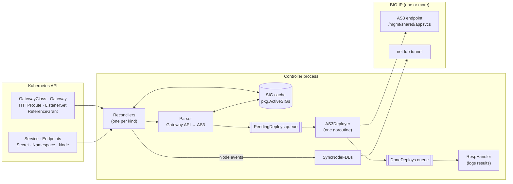
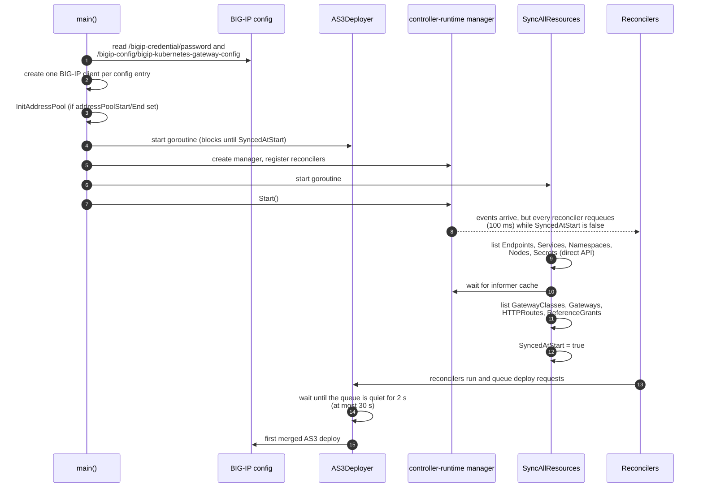
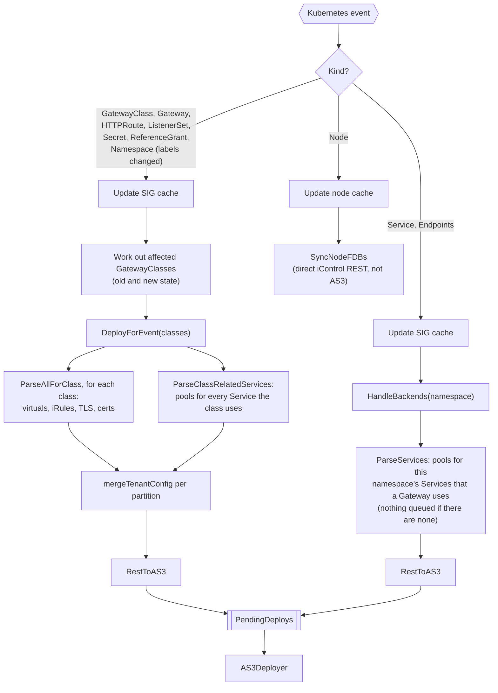
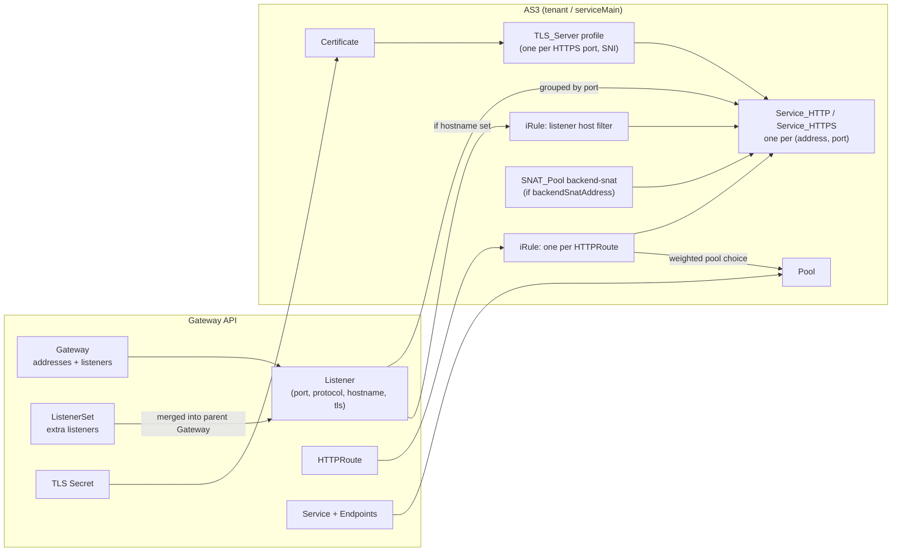
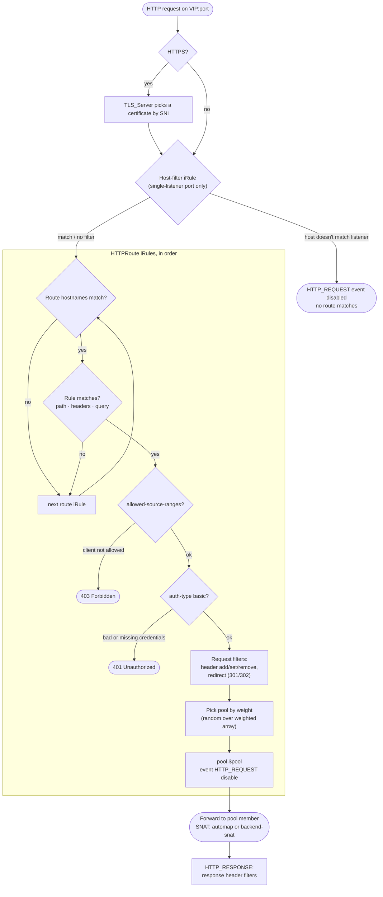
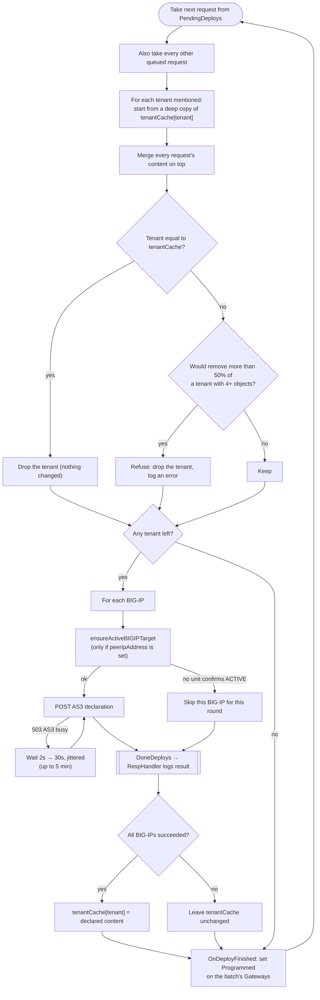
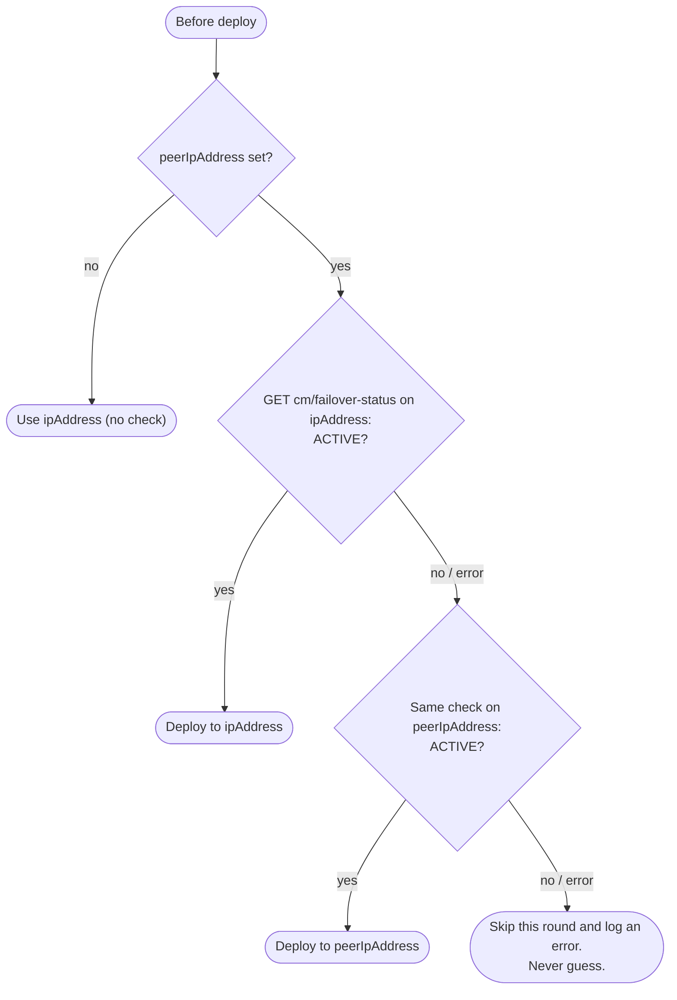
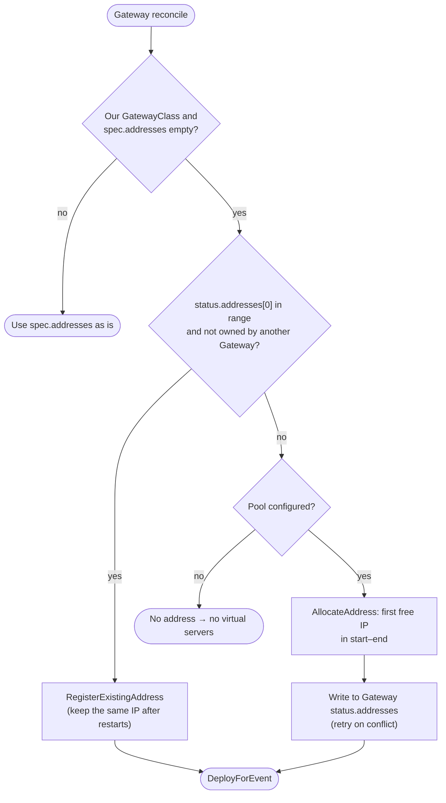
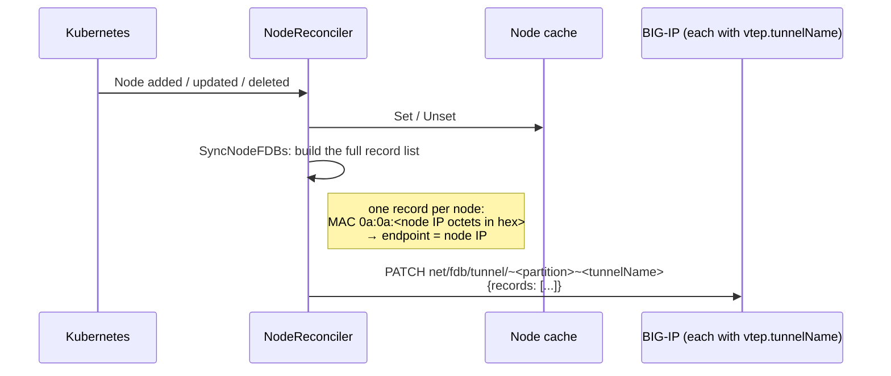
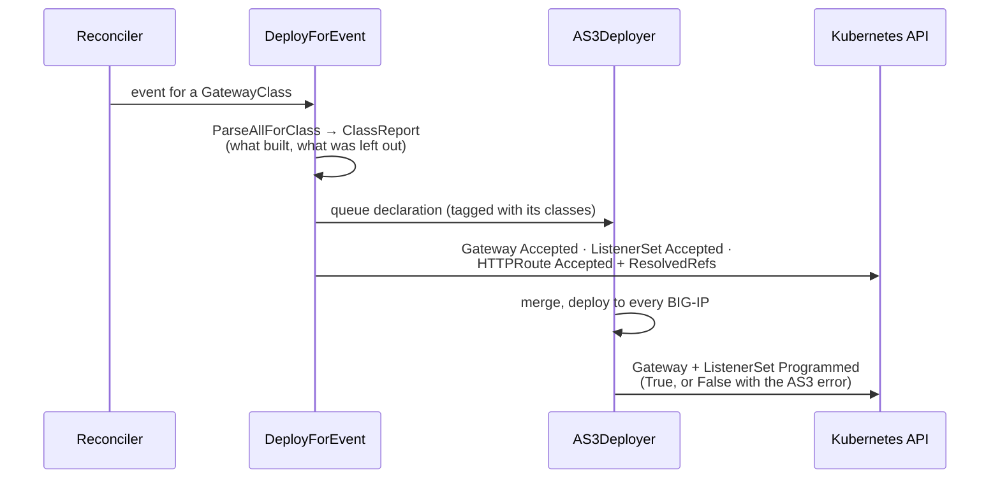

# Controller internals

This document explains how the bigip-kubernetes-gateway controller turns Gateway API resources into BIG-IP configuration. It is for people who operate, debug or change the controller. For install steps and the flag reference, see the [README](../README.md).

- [Architecture](#architecture)
- [Startup](#startup)
- [From Kubernetes event to BIG-IP](#from-kubernetes-event-to-big-ip)
- [What each reconciler does](#what-each-reconciler-does)
- [Translating to AS3](#translating-to-as3)
- [How BIG-IP handles a request](#how-big-ip-handles-a-request)
- [The AS3 deployer](#the-as3-deployer)
- [HA failover](#ha-failover)
- [Gateway VIP auto-assignment](#gateway-vip-auto-assignment)
- [Pool members](#pool-members)
- [Cilium VTEP FDB sync](#cilium-vtep-fdb-sync)
- [Admission webhook](#admission-webhook)
- [HTTPRoute features and annotations](#httproute-features-and-annotations)
- [Status](#status)
- [Observability](#observability)
- [Known limitations](#known-limitations)

## Architecture

The controller is a single process. It keeps its own in-memory copy of every relevant Kubernetes object, called the SIG cache (`pkg.ActiveSIGs`). Reconcilers update that cache, then work out which BIG-IP configuration is affected and queue a deploy. A single deployer goroutine merges the queued requests and posts them to every configured BIG-IP as an AS3 declaration.



Main packages:

| Package | Role |
|---|---|
| [cmd/controller](../cmd/controller/main.go) | Reads flags and config, connects to the BIG-IPs, starts the manager, reconcilers and deployer |
| [internal/controllers](../internal/controllers) | One reconciler per watched kind |
| [internal/pkg/cache.go](../internal/pkg/cache.go) | SIG cache, plus lookups such as "which Gateways does this HTTPRoute attach to" |
| [internal/pkg/parser.go](../internal/pkg/parser.go) | Builds virtual servers, pools, TLS profiles and certificates |
| [internal/pkg/iruletmpl_parser.go](../internal/pkg/iruletmpl_parser.go), [irule_templates/](../internal/pkg/irule_templates) | Builds one iRule per HTTPRoute |
| [internal/pkg/utils.go](../internal/pkg/utils.go) | `DeployForEvent`, `HandleBackends`, `AS3Deployer`, HA target selection |
| [internal/pkg/addresspool.go](../internal/pkg/addresspool.go) | VIP auto-assignment |
| [internal/pkg/nodefdb.go](../internal/pkg/nodefdb.go) | Cilium VTEP FDB sync |
| [internal/k8s](../internal/k8s) | Node cache, and conversion of Service and Endpoints into pool members |
| [internal/webhooks](../internal/webhooks) | Optional validating admission webhook (separate binary) |

## Startup



Why it works this way:

- **Reconcilers wait for `SyncedAtStart`.** Without the full cache, a reconciler would build a declaration from partial data. For example, it could see an HTTPRoute before its Services are cached.
- **The deployer waits for the startup burst to settle.** After the sync, every reconciler fires at once, and each one queues only its own slice of a tenant. The deployer waits until no new requests have arrived for 2 seconds, so the first deploy contains everything.
- **The initial sync does not load ListenerSets.** They enter the cache through their own reconciler shortly after the sync finishes.

## From Kubernetes event to BIG-IP

There are three deploy paths. Which one runs depends on the kind of object that changed.



A reconciler that returns an error is retried by controller-runtime with backoff. The code returns *retryable* errors on purpose when a dependency isn't cached yet: a GatewayClass, a Service, Endpoints or a Node. A missing dependency then causes a retry, not a silent empty pool.

### When one object can't be built

One broken object never blocks the rest of its GatewayClass. `ParseAllForClass` builds each Gateway and each HTTPRoute separately, and leaves out the ones that fail:

| What fails | Examples | What gets deployed |
|---|---|---|
| An HTTPRoute | Unsupported `f5-bigip/auth-type`, missing basic-auth Secret, invalid `allowed-source-ranges`, RequestMirror filter | Everything else. If the route built successfully earlier in this pod's lifetime, its **last good iRule stays in place**, so a bad edit doesn't take a working app offline. A route that never built is left off its virtual server |
| A Gateway | Two HTTP listeners on one port, TCP/UDP/TLS listener, non-IP address | Everything else. The Gateway's objects are left out of the declaration, so BIG-IP keeps whatever it had for that Gateway before |
| A Service | Unsupported type (`LoadBalancer`, `ExternalName`) | Every other pool. Routes that use that Service get no backend |

`DeployForEvent` queues the rest first, writes the problem into the object's [status](#status), and then returns an error naming what was skipped. Returning the error makes controller-runtime retry with backoff, so the problem keeps showing in the logs and is picked up once fixed. That covers fixes this controller doesn't watch for directly, such as creating a basic-auth Secret after the route that names it.

The last good iRules are kept in memory. After a pod restart, a route that still fails to build is left out until it is fixed.

## What each reconciler does

| Kind | On create or update | On delete | Deploy path |
|---|---|---|---|
| GatewayClass | Cached even if another controller owns it. Deploys only if the class is ours | Removed from cache | `DeployForEvent` |
| Gateway | Auto-assigns a VIP if needed (see [below](#gateway-vip-auto-assignment)), then caches | Removed from cache | `DeployForEvent` for its class |
| HTTPRoute | Caches. Redeploys the classes of the Gateways it was attached to and the ones it is attached to now | Redeploys the classes it was attached to | `DeployForEvent` |
| ListenerSet | Caches. Redeploys the class of its parent Gateway, before and after the change | Same | `DeployForEvent` |
| Secret | Caches. Redeploys the classes of Gateways whose listeners reference it | Logs a warning if Gateways still reference it. No redeploy | `DeployForEvent` |
| ReferenceGrant | Caches. Redeploys classes whose cross-namespace references it affects | Same | `DeployForEvent` |
| Namespace | Redeploys affected classes, only when labels change (labels drive `allowedRoutes` selectors) | Removed from cache | `DeployForEvent` |
| Service, Endpoints | Caches | Removed from cache | `HandleBackends(namespace)` |
| Node | Updates the node cache | Same | `SyncNodeFDBs` |

The controller only builds configuration for GatewayClasses whose `spec.controllerName` matches `--controller-name`. It still caches other controllers' classes so it can tell "not ours" apart from "not cached yet".

## Translating to AS3

### Object mapping



### Declaration layout

```text
AS3 (action: deploy, persist: false)
└── ADC (schemaVersion 3.19.0)
    └── <partition>                      Tenant
        └── serviceMain                  Application
            ├── gw.<ns>.<gw>.shared-<port>.<i>          Service_HTTP / Service_HTTPS
            ├── gw.<ns>.<gw>.shared-<port>.tls-server   TLS_Server
            ├── scrt.<ns>.<secret>                      Certificate
            ├── gw.<ns>.<gw>.<listener>                 iRule (host filter)
            ├── hr.<ns>.<route>                         iRule (routing)
            ├── pool.<ns>.<service>                     Pool
            └── backend-snat                            SNAT_Pool (optional)
```

### Partitions

Without `partition` in the config file, configuration is split across two kinds of tenant:

- Virtual servers, iRules, TLS profiles and certificates go in a tenant named after the **GatewayClass**.
- Pools go in a tenant named after the **Service's namespace**.

When `partition` is set, `ResolvePartition` sends everything to that single partition, and `mergeTenantConfig` combines the pieces instead of letting one overwrite another. Use this when the VTEP tunnel, self IPs and routes live in one per-environment partition, because BIG-IP can only route to pools in a partition that can see those network objects.

### Listener grouping

All listeners on the same port share one virtual server, whether they come from the Gateway or from attached ListenerSets. Two virtual servers on the same IP and port would be rejected by AS3. Rules for a shared port:

- Only HTTPS listeners can share a port. Two HTTP listeners on one port return an error.
- One TLS_Server profile carries every listener's certificate. A listener with no hostname, or with a wildcard hostname, is the SNI default. The others get `matchToSNI: <hostname>`.
- The virtual server name is always keyed by port (`shared-<port>`), even with a single listener. This way, attaching or detaching a ListenerSet never renames the virtual server.
- If no certificate has resolved yet for an HTTPS port (for example, cert-manager is still issuing it), that virtual server is skipped and the rest of the Gateway still deploys.
- `redirect80` is always `false`. AS3's automatic port-80 redirect virtual would collide with the Gateway's own HTTP listener.

### Gateway addresses

The virtual server address comes from `spec.addresses`. If that is empty, it comes from `status.addresses`, which is where auto-assigned VIPs are written. Only `IPAddress` is supported. A Gateway with no address gets no virtual servers.

## How BIG-IP handles a request

Each virtual server has an ordered list of iRules. Single-listener and shared ports differ:

- **Single listener on the port:** the listener's host-filter iRule comes first, then the HTTPRoute iRules.
- **Several listeners on the port:** host-filter iRules are left out, because one would disable the whole chain for the other listeners' hosts. The HTTPRoute iRules are sorted with exact hostnames first, then wildcard, then none. Each route iRule checks its own hostnames anyway.

Within the same hostname specificity, routes are ordered by path specificity: Exact paths first, then longer prefixes.



After a route matches, its iRule disables `HTTP_REQUEST` for the remaining iRules. Later iRules, such as a catch-all HTTPS redirect, therefore can't override the pool it chose.

Weighted pools are built in `RULE_INIT`. Each rule gets a Tcl array with one entry per weight unit, and the array name is prefixed with the route's partition, namespace and name (`static::pools_pK8S_2dD_ns6_argocd_argocd_server_0`). The prefix matters because `static::` variables are shared across every iRule on the box, including those of other clusters' controllers on the same BIG-IP. Without the partition, dev and tst wrote the same arrays for their identical routes, and one cluster's virtual servers sent traffic to the other cluster's pools.

## The AS3 deployer

`AS3Deployer` is the only place that talks to AS3. It runs on a single goroutine, so deploys never overlap. It keeps `tenantCache`, which holds the last declaration that deployed successfully for each tenant.



Each step guards against a specific failure:

- **Seeding from `tenantCache`.** Each event only knows its own slice of a tenant: one namespace's pools, or one class's virtual servers. AS3 replaces everything in a declared tenant, so posting a single slice would delete every other app in that partition. Seeding from the last good state prevents that.
- **The removal guard.** It catches a declaration that is valid but incomplete before it wipes a tenant.
- **Not clearing the cache on failure.** If one deploy fails, the next small event still merges onto the full previous state.
- **Waiting out a busy AS3.** AS3 handles one declaration at a time per BIG-IP, across all partitions. When another controller shares the BIG-IP (for example dev and tst writing `K8S-D` and `K8S-T`), a POST can get `503 Configuration operation in progress`. Nothing re-sends a failed batch, so the deployer retries the POST itself, logging a warning each time, with backoff and jitter so two controllers don't keep colliding in step. New events queue up meanwhile and go out merged in the next batch. After 5 minutes it gives up and reports the failure.

There is a known trade-off. Because of the seeding, a deleted app's pool or virtual server can remain on BIG-IP as an orphan until a full recompute of that tenant. This was chosen on purpose: an unused orphan pool is less harmful than an emptied VIP.

## HA failover

If a config entry has `management.peerIpAddress`, the controller checks before every deploy which unit is active. It checks again each time and doesn't cache the answer, because a failover can happen at any moment.



## Gateway VIP auto-assignment

This applies when `addressPoolStart` and `addressPoolEnd` are set and a Gateway has no `spec.addresses`. Only Gateways whose class this controller owns are considered. Gateways that belong to other controllers, such as Cilium, are never touched.



The pool lives only in memory. After a restart it is rebuilt from each Gateway's `status.addresses` as the Gateways are reconciled. If two Gateways claim the same IP, the second one gets a new address and an error is logged.

## Pool members

Each Service a Gateway uses becomes one pool named `pool.<namespace>.<service>`. The iRules refer to it as `/<partition>/serviceMain/pool.<namespace>.<service>`. The namespace is part of the name because, with `partition` set, every namespace's pools share one tenant, and two Services with the same name would otherwise overwrite each other. Both the pool declaration (`ParseServices`) and the iRule reference (`parsePoolweight`) get the name from `poolName()`.

`FormatMembersFromServiceEndpoints` decides what goes into each pool:

| Service type | Members |
|---|---|
| `ClusterIP` | Pod IPs from Endpoints, on the Endpoints port. Requires the pod's node to be in the node cache |
| `NodePort` | Every node's IP, on the Service's `nodePort` |
| `LoadBalancer`, `ExternalName` | Not supported (error) |

If an HTTPRoute `backendRef` sets a `port`, only that Service port is included. Otherwise all ports are included. Members are de-duplicated by IP and port. The pool monitor is always `tcp`.

A missing Service or Endpoints in the cache is a retryable error, not an empty pool. A Service whose Endpoints exist but have no ready addresses deploys as an empty pool, which is correct.

Only Services that some Gateway of ours actually uses become pools, through `GetRootGateways`.

## Cilium VTEP FDB sync

With Cilium VTEP, BIG-IP reaches pod IPs through a VXLAN tunnel. The tunnel needs one FDB record per Kubernetes node. F5 CIS does this for Flannel. This controller does it for Cilium.



Every call sends the complete desired set, not a diff, so the records repair themselves. This uses iControl REST directly, not AS3. The tunnel, self IP and routes are created by hand on BIG-IP. The controller only maintains the FDB records.

### Pod ARP entries

The FDB alone isn't enough. When BIG-IP ARPs for a pod over the tunnel it learns the pod's own MAC, which is in no FDB record, so it floods every packet for that pod to every node. The pod then gets each SYN once per node, answers each copy, and BIG-IP resets the replies it doesn't expect: health checks flap and client connections are reset at random.

`PodARPSyncer` therefore keeps a static ARP entry for every pool member: pod IP → `0a:0a:<hex of its node's IP>`, the same MAC as that node's FDB record, so BIG-IP sends each packet straight to the node hosting the pod. This is the same pairing F5 CIS uses.

- Entries are named `k8s-pod-<pod IP>` and live in `vtep.tunnelPartition`. Only entries with that prefix in that partition are changed or removed, so other clusters' partitions and entries made by hand are left alone.
- Pool members are the ready Endpoints addresses of ClusterIP Services used by this controller's routes. Pods on the host network are skipped: BIG-IP reaches node IPs without the tunnel.
- Service, Endpoints, route, Gateway and node changes trigger a sync, debounced by 2 seconds. A full resync also runs every 5 minutes. Each pass reads the partition's ARP entries from BIG-IP and writes only the difference.
- It waits for the initial cache sync, so a restart doesn't remove entries for pods that simply haven't been cached yet.

When Cilium VTEP is used, also set `backendSnatAddress` to the tunnel's self IP. With SNAT automap, BIG-IP may source backend connections from a self IP outside the tunnel's CIDR. Cilium drops the return traffic for those connections, and they reset after about 12 seconds.

## Admission webhook

The webhook is a separate binary ([cmd/webhook](../cmd/webhook/main.go)) that serves HTTPS on port 9443. Each check runs only when its key is passed in `--validates`.

| Key | Resource / operation | Rejects when |
|---|---|---|
| `gateway.gatewayClassName` | Gateway create/update | The referenced GatewayClass doesn't exist |
| | GatewayClass delete | Gateways still use the class |
| `gateway.listeners.tls.certificateRefs` | Gateway create/update | An HTTPS listener refers to a missing Secret, a reference isn't a core Secret, or a cross-namespace reference has no ReferenceGrant |
| `httproute.parentRefs` | HTTPRoute create/update | A parentRef has no `sectionName`, isn't a `Gateway`, names a Gateway that doesn't exist, or names a listener that doesn't allow the route's namespace |
| | Gateway delete | HTTPRoutes still reference the Gateway |
| `httproute.rules.backendRefs` | HTTPRoute create/update | A backend Service (or ExtensionRef Service) is missing, isn't a core Service, or is in another namespace without a ReferenceGrant |

The controller binary accepts the same `--validates` flag, but nothing in the controller acts on it. The checks only run in the webhook.

Don't enable `httproute.parentRefs` if you use ListenerSets. It rejects any HTTPRoute whose parentRef is a ListenerSet or has no `sectionName`. The cert-manager HTTP-01 solver route has both.

## HTTPRoute features and annotations

| Feature | Supported |
|---|---|
| Listener protocols | `HTTP`, `HTTPS` (TLS terminate). `TCP`, `UDP` and `TLS` return an error |
| Hostnames | Exact and wildcard, on both the route and the listener |
| Path match | `PathPrefix` (default), `Exact`, `RegularExpression` |
| Header and query match | `Exact`, `RegularExpression` |
| Request header modifier | add, set, remove |
| Response header modifier | add, set, remove |
| Request redirect | scheme, hostname, port, full-path replace, status 301 or 302 |
| Backend weights | Yes |
| Cross-namespace backends | Yes, with a ReferenceGrant |
| RequestMirror | No (error) |
| URLRewrite | No (ignored) |
| ExtensionRef | Sends the request to pool `/cis-c-tenant/<ns>.<name>`, a convention inherited from upstream |

Annotations on an HTTPRoute, which apply to every rule in it:

| Annotation | Effect |
|---|---|
| `f5-bigip/allowed-source-ranges` | Comma-separated CIDRs or IPs. Other clients get `403` |
| `f5-bigip/auth-type: basic` | Requires HTTP Basic auth. Any other value is an error, so a typo can't leave the route unprotected |
| `f5-bigip/basic-auth-secret` | Name of a Secret in the route's namespace with `username` and `password` keys |

## Status

The controller writes standard Gateway API status, so `kubectl get gateway,listenerset,httproute -A` shows whether config reached BIG-IP, without reading logs. Status is written in two steps:



| Object | Condition | Set to |
|---|---|---|
| Gateway | `Accepted` | `True`, or `False` / `ListenersNotValid` with the reason it couldn't be built |
| | `Programmed` | `True` after the deploy succeeds. `False` / `Invalid` with the AS3 error, or a refused or HA-skipped deploy. `False` / `AddressNotAssigned` when it has no address |
| ListenerSet | `Accepted` | `True`, or `False` / `NotAllowed` when the parent Gateway's `allowedListeners` refuses it |
| | `Programmed` | Same as its parent Gateway |
| HTTPRoute, per parentRef | `Accepted` | `True`. `False` / `NotAllowedByListeners` when no listener accepts the route. `False` / `UnsupportedValue` when it can't be built, with a note if the previous version is still served |
| | `ResolvedRefs` | `True`. `False` / `BackendNotFound`, `RefNotPermitted` or `InvalidKind` naming the backendRef |

Notes:

- **HTTPRoute status is shared.** The controller only adds and replaces entries with its own `controllerName` (`--controller-name`), for parentRefs that point at its Gateways. Entries from other controllers, such as Cilium, are kept.
- **Writes only happen on a real change.** Every status write triggers another reconcile. The writer compares everything except `lastTransitionTime` and skips the write when nothing changed, so this settles after one round.
- **`Programmed` is per batch.** The deployer merges several requests into one AS3 call, so a failure marks every Gateway in that batch as not programmed.
- **Missing permissions only log a warning.** The ClusterRole needs `update` on `gateways/status`, `httproutes/status` and `listenersets/status`. Without it, each write logs a warning and deploys continue.

## Observability

| Endpoint | Port | Content |
|---|---|---|
| `/metrics` | 8080 | Prometheus: function timings and iControl call timings |
| `/healthz`, `/readyz` | 8081 | Liveness and readiness (ping only) |
| `/debug/pprof/` | 6060 | Go pprof. Use `goroutine?debug=2` to find where a stuck deploy is waiting |

Start with [status](#status): `kubectl get gateway -A` shows `PROGRAMMED`, and `kubectl describe httproute <name>` shows why a route wasn't accepted.

Every error and configuration problem is also logged by the controller pod, whether or not status could be written:

| Level | What |
|---|---|
| `ERROR` | AS3 deploy failures, refused tenants, HA "no active unit", FDB sync failures, and each Gateway or HTTPRoute left out of a declaration (`left out of the declaration: ...`) |
| `WARN` | Configuration problems: a route no listener accepts, unresolved backendRefs, a missing or non-permitted certificate, an HTTPS port with no usable certificate, a parentRef without `sectionName`, a ListenerSet that isn't allowed, a Gateway without an address, failed status writes |
| `INFO` | `<object>: resolved` when one of those warnings clears |

Warnings are logged once when the problem first appears in this pod (and again if the message changes), not on every reconcile. A restarted pod logs every problem that still exists. To list current problems: `kubectl logs deploy/f5-bigip-gateway -n kube-system | grep -E 'WARN|ERROR'`.

Every reconcile gets a request ID, and log lines carry it. When the deployer merges several requests, it logs `merged requests [ids]: tenants: [...]`, so you can follow one Kubernetes event through to the deploy. Set `--log-level debug` to log the full AS3 body of every deploy.

## Known limitations

- **`port` is required in the config file.** If it is missing, the controller dereferences a nil pointer and crashes on startup ([cmd/controller/main.go](../cmd/controller/main.go), `setupBIGIPs`).
- **Orphans after deletes.** See [The AS3 deployer](#the-as3-deployer).
- **ReferenceGrant reconcile errors are swallowed.** `ReferenceGrantReconciler` returns `nil` when `DeployForEvent` fails, so that event is not retried.
- **Deleting an uncached Gateway panics.** If a Gateway is deleted before it was ever cached, the delete path dereferences a nil cache entry.
- **The ListenerSet CRD must exist.** The controller watches ListenerSet, but none of the bundled CRD manifests include it.
- **`--deploy-method` does nothing.** Deployment always uses AS3.
